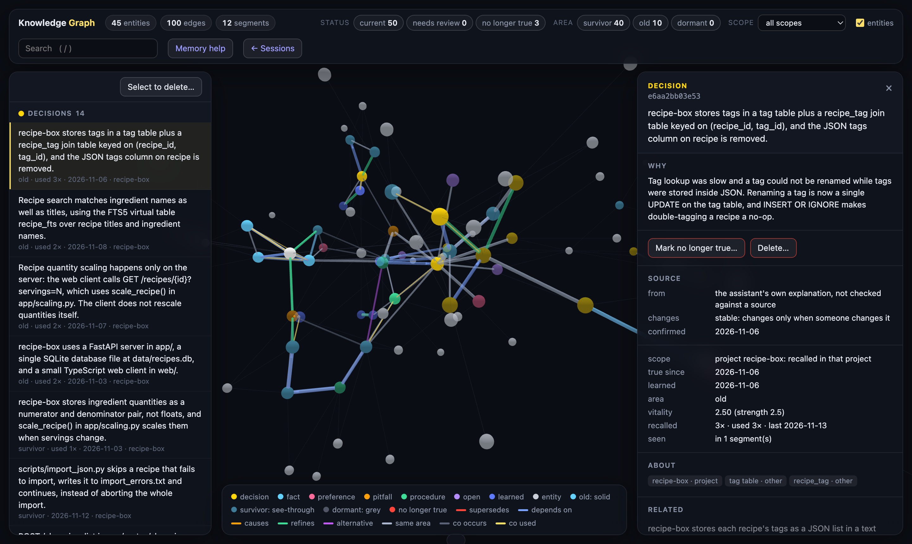
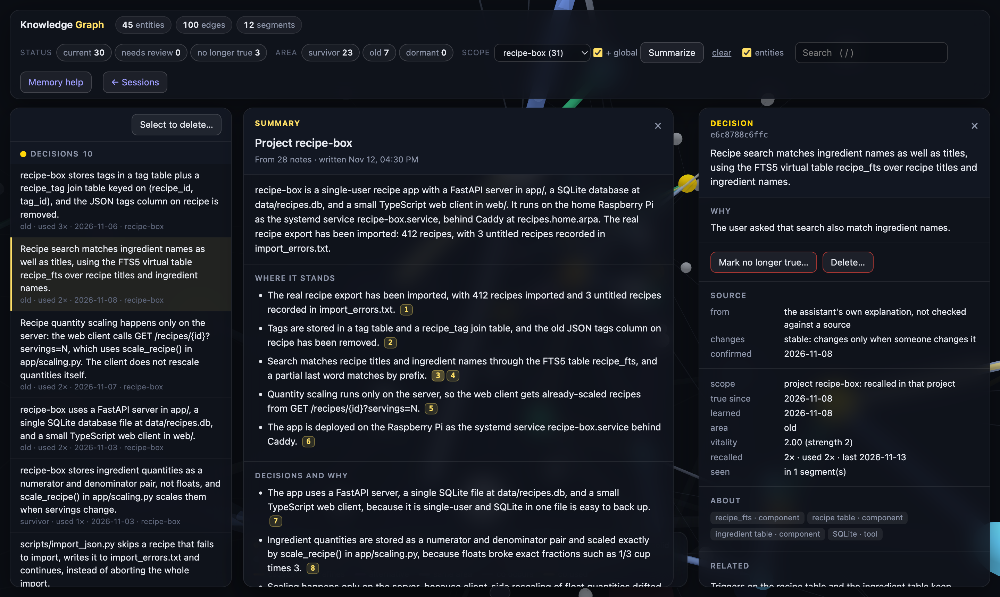

# graph-memory

Long-term memory for Claude Code, kept as a knowledge graph on your own machine.

Claude Code starts every session knowing nothing about the last one. graph-memory records
each session while you work, has a small model distil it into single notes (decisions,
facts, preferences, pitfalls, procedures, open items, things you learned by asking), and
shows Claude the few notes that apply before each reply.



*The Knowledge page: notes coloured by type and the links between them, with one note
open. The data is a demo: an invented recipe app.*

What is different about it:

- **Notes, not transcripts.** A session's exchanges wait in a small buffer. When the
  session compacts, goes quiet or ends, they **graduate** into notes, each with its
  reason, date and source, and the exchanges are deleted. Only the knowledge is kept.
- **A graph, not only a search.** **Recall** finds notes by meaning and by words, then
  follows the links between notes (Personalized PageRank), so the reason behind a
  decision or the pitfall about a file comes along. It takes about 7 ms and calls no
  model.
- **Memory that ages.** Notes that are never used fade and stop being recalled. A
  reversed decision is retired but kept for history. A note a reply contradicts is
  marked disputed. Nothing is deleted unless you delete it, and that can be undone.
- **Scoped.** A note belongs to one project, to one topic such as SQLite (recalled in
  any project once the session is about it), or to you globally.
- **Yours to inspect.** Everything stays on your machine, in one SQLite file
  (`~/.graph-memory/memory.db`) that `gm export` writes out as JSON, with keys and
  passwords [redacted](#secrets) before anything is kept. A local web page
  shows the graph, lets you correct or delete notes, and writes a **summary** of a
  project or topic in which every point links to the notes behind it.



*A summary of one project. Each number opens the note the point rests on.*

It needs Claude Code, Python 3.11 or later and [uv](https://docs.astral.sh/uv/). The
model calls go through `claude -p` with your existing login.

**[How it works](https://claude.ai/artifact/XrMqJVbNAjrivracZamnyz)** walks through
remembering, recall, how memory ages, summaries and the Knowledge page, with diagrams and
examples. The rest of this README is the reference.

```
agent hook ──▶ gm (exits in ms) ──Unix socket──▶ daemon ──▶ ~/.graph-memory/
                                                   │          memory.db               kept for good: items, entities, edges,
                                                   │                                  their vectors, deletions to undo,
                                                   │                                  summaries (a cache)
                                                   │          sessions/<session>/     exchanges until they graduate
                                                   │          events.jsonl            what happened, 30 days
                                                   └─ background: graduation, use checks, note judging
```

## Install

```sh
git clone https://github.com/xihe92/graph-memory
uv tool install --managed-python --editable ./graph-memory   # puts `gm` on your PATH
```

`--managed-python` installs graph-memory on uv's own Python build. Memory is kept in
SQLite and searched with the [sqlite-vec](https://github.com/asg017/sqlite-vec)
extension, and Python's `sqlite3` module can load extensions there; some Python builds
(pyenv's default, the macOS system Python) leave that out, and on them the daemon does
not start (`~/.graph-memory/gm.log` says why).

The first daemon start downloads the embedding model (all-MiniLM-L6-v2, about 90 MB,
pinned and checked against its SHA-256) from Hugging Face to
`~/.cache/graph-memory/models`. It then runs offline on the CPU. Graduation calls
`claude -p --model haiku` with your existing login.

## Claude Code hooks

Add to `~/.claude/settings.json` (all projects) or `.claude/settings.json` (one project):

```json
{
  "hooks": {
    "SessionStart":     [{ "hooks": [{ "type": "command", "command": "gm start" }] },
                         { "matcher": "compact",
                           "hooks": [{ "type": "command", "command": "gm graduate" }] }],
    "UserPromptSubmit": [{ "hooks": [{ "type": "command", "command": "gm recall" }] }],
    "Stop":             [{ "hooks": [{ "type": "command", "command": "gm remember" }] }],
    "SessionEnd":       [{ "hooks": [{ "type": "command", "command": "gm graduate" }] }]
  }
}
```

Hooks never block Claude Code: on any error they log to `~/.graph-memory/gm.log` and exit 0.

**Sessions a program drives** (`claude -p`, the Agent SDK; Claude Code tells the hooks
through `CLAUDE_CODE_ENTRYPOINT`) are neither recalled into nor remembered: they are
usually scripts and checks, not your work. Set `remember_headless = true` to treat them
like any other session. A slash command is remembered as the prompt `/name args`; a
background-task notification is not a prompt, and the reply it leads to extends the
exchange that started the task.

## Commands

`gm <command> --help` shows a command's options, and `gm knowledge <action> --help`
an action's.

| Command | What it does |
|---|---|
| `gm status` | Buffer (sessions and exchanges waiting), knowledge counts, graduation queue |
| `gm knowledge` | Items by type, with their entities (`--all` includes ones no longer true) |
| `gm knowledge show <id>` | One item or entity, its neighbours and the graduations it came from |
| `gm knowledge backfill` | Graduate every session waiting in the buffer now |
| `gm knowledge graduate <session> [--wait]` | Graduate one session's waiting exchanges now (an id prefix will do); the session goes on. Also "Graduate now" on the Sessions page |
| `gm knowledge regraduate <session> [--preview \| --force] [--wait]` | Graduate a whole session again from Claude Code's transcript (kept 30 days), under the current rules. It is replayed in order, one graduation per part, so later decisions retire earlier ones; what it taught before, including what is no longer true, is matched rather than added again; its summaries become one. `--preview` runs it on a copy of memory and shows what would change. A session that replays in more than two parts is always previewed first, because a long session whose design moved on can bring back many outdated items; `--force` changes memory directly |
| `gm knowledge resummarize <session>` | Fold a session's summaries into one, written from what it taught; knowledge is not touched (for a long session where graduating again would do more harm than good) |
| `gm knowledge regraduate <session> --apply` | Keep a preview (refused if memory learned or lost something since) |
| `gm knowledge retract <id> [--reason …]` | Mark an item no longer true by hand: kept for history, never recalled |
| `gm knowledge restore <id>` | Make an item true again (undoes a retraction or the model's invalidation) |
| `gm knowledge review` | Disputed items, items due for review, and deletions you can undo |
| `gm knowledge confirm <id>` | It still holds: clears a dispute and starts its review period over |
| `gm knowledge delete <id>… [--reason …] [--yes]` | Remove noise for good; neighbours linked through it stay linked (below) |
| `gm knowledge undelete <batch>` | Put a deletion back as it was |
| `gm knowledge rescope [--wait]` | The model reads every item and proposes where it should be recalled (project, topic, global); nothing changes yet. `--wait` shows the proposal |
| `gm knowledge rescope --apply` | Keep the proposal (an item whose scope changed since keeps its own) |
| `gm knowledge scope <id>… --to <scope>` | Set items' scope by hand: `global`, `topic:<name>`, or a project's name |
| `gm knowledge summarize <scope> [--force]` | Print a brief of what memory knows about one project or topic (`global`, `topic:<name>`, or a project's name). The model writes it when notes changed since the last one; `--force` writes it again anyway |
| `gm stats [--since 24h\|7d\|all] [--json]` | Hook latency, graduations, the buffer, and **Memory help**: how often recall gave Claude notes and replies used them |
| `gm ui [--no-open] [--port N]` | Open the web page (below); starts the daemon if needed |
| `gm migrate [--dry-run]` | Move a memory kept in JSON files into `memory.db` (see Where memory is kept) |
| `gm export [folder]` | Write memory out as JSON files, to read in any editor (the daemon can keep running) |
| `gm stop` | Stop the daemon (it also stops itself after 30 idle minutes) |

## The session buffer

```
~/.graph-memory/sessions/claude-code:<session>/chain.jsonl
  {"kind": "summary", "trigger": "idle", "exchanges": 23, "graduations": 4, "items": [...], "text": "<the session so far>"}
  {"kind": "exchange", "prompt": "...", "reply": "...", "files": [...], "project": "repo:/..."}
  {"kind": "exchange", ...}
```

A reply's arrival appends one exchange line: no vectors, no model call. What happens next:

| Event | The buffer |
|---|---|
| 20 quiet minutes | The exchanges since the last summary graduate. The graduation reads the session's summary so far and writes the next one (2-4 sentences: the problem, what was decided or learned, what is open); once the new knowledge is saved, the exchanges are replaced by it. A session keeps **one rolling summary**: each graduation folds into it, so a slow session of questions doesn't leave a string of summaries. |
| Compaction | The same, with Claude's own summary as context; Claude's summary becomes a summary line of its own, and the next graduation starts a new rolling summary after it. |
| Session end | What is left graduates, then the session's folder is deleted. |
| Rewind | Exchanges after the point you rewound to are dropped before they can graduate. |
| Graduation fails | Nothing is deleted; the next trigger retries. After 3 failures, or once the oldest exchange is 3 days old, they are given up on and an event records it. |
| Untouched for 7 days | One last graduation, then the folder is deleted. |

Knowledge is saved before the buffer file is rewritten, and the rewrite is atomic, so a
crash at worst graduates the same exchanges twice; merging removes the duplicates.
Without a model (`model_backend = "none"`) nothing is learned and a session's exchanges
go when it ends.

## Knowledge graph

```
entity ◀─about─ item ─related(type, weight)─▶ item
                 └─sources─▶ (session, newest exchange that taught it)
```

- **Items** are single pieces of knowledge: a decision and why, a fact about the setup,
  a preference or correction from you, a pitfall and its fix, a procedure, an open item
  (unfinished work, an open question, options weighed and the current leaning), or what
  you learned by asking how a tool, library or concept works, written as it applies to
  your work. Each has a scope (below), when it became true, its sources, how often it
  was seen again, and where it came from (below).
- **Scope** decides where an item is recalled, and the model picks it as it learns the
  item: **project** (one repo's own code, design or work), **topic** (one technology,
  product or subject, such as SQLite or Redis: recalled in any project, but only once
  the session is about it, meaning the prompt, a waiting exchange or the session's
  summary names it), or **global** (you, your machine, how you like to work). Topics
  keep one spelling. A session outside any repo can still learn project-like decisions:
  they go to their topic. `gm knowledge rescope` has the model re-check every item's
  scope, and `gm knowledge scope` sets one by hand.
- **Entities** are the named things items are about: files, code symbols, components,
  tools, projects, people by role, the machine. They anchor items that share a subject.
- **Edges** between items are typed (depends on, causes, refines, alternative, same area)
  with a weight; items learned together about the same entity get a weak co-occurrence
  edge without any model call.
- **No longer true is kept.** When a new item makes an old one false, the old one gets
  the date it stopped being true and a `supersedes` edge from the new one. Only you
  delete items (below).
- **Sources** replace links to exchanges, which are gone once graduated: one entry per
  session that taught the item, with the time of the newest exchange that did.

**Graduation pipeline** (in the background: one extract call per 40,000 characters of
exchanges, plus one merge call when new items need comparing with existing ones):

1. *Extract*: the exchanges (with the pages read and searches run in each, plus the
   session's summary so far, or Claude's own after a compaction) go to the model, which
   lists entities and items with where each came from, and writes the next summary.
   Knowledge that is durable, useful later and specific is kept, including what you
   learned by asking; options weighed are kept as open items with the current leaning;
   a finished or dropped open item is stated as done.
2. *Resolve entities* without the model where possible (the approach is Graphiti's):
   exact name, then character 3-gram Jaccard ≥ 0.9 for names long and varied enough to
   compare fuzzily, then embedding candidates (≥ 0.6) left for the model.
3. *Merge*: an identical statement is reinforced directly. The rest go to one model call
   with existing items about the same entities or close in meaning, which says for each
   new item: duplicate of, makes false (only when both cannot be true at once), and
   related to (type and strength).
4. *Apply*: reinforce, invalidate, add items, entities and edges.

If the merge call fails, the extracted items are still kept.

Items normally become no longer true when a later session states what replaced them,
including an open item that was done or dropped, or a newer state of the same open
question. `retract` is for when no session says so, or the model missed it.

### Stale knowledge

What memory learned can stop being true, above all what you learned about tools that
keep changing. Each item records:

| Field | Values |
|---|---|
| `origin` | `user` (you said it), `docs` or `code` (read during the session: a page fetched, a file read), `observed` (tool output, a test run), `assistant` (the assistant's own explanation, not checked against a source) |
| `applies_to` | the version or context it holds for, e.g. `SQLite 3` |
| `volatility` | `stable` (concepts, decisions, preferences, open items), `versioned` (how a release of a tool or API behaves: due for review 180 days after it was last confirmed), `volatile` (latest versions, prices, status of things outside your control: due after 30 days, and no longer recalled once due) |

Four things keep a stale note from polluting a session:

1. **Honest notes.** Each recalled note shows when it was last confirmed and where it came
   from (`[learned, 2026-11-07, from docs, SQLite 3] …`), and the block tells the agent
   that what it sees now in code, docs or tool output wins over a note.
2. **Contradictions act.** Every turn that showed a versioned or volatile note, or
   something learned from the assistant's own explanation, is judged, not just the
   sample. A note the reply shows false (from code, docs or tool output) is
   **disputed**: shown with a warning from then on. Contradicted again, it is retracted.
   A change the reply itself makes doesn't count: the note was right until then.
3. **Replacement.** The next graduation states what is true now, and the merge makes the
   old item false; an answer read in the docs replaces one the assistant only explained.
4. **Review dates.** A versioned item past its review is shown with "not re-checked
   since …, verify it"; a volatile one stops being recalled. Stating it again in a later
   session, or `gm knowledge confirm`, starts the review period over.

`gm knowledge review` and the "needs review" filter on the Knowledge page list what is
disputed or due.

### Deleting by hand

`retract` says an item is wrong and keeps it as history; `delete` is for noise that was
never worth keeping. A deleted item leaves the graph with its edges, and so do entities
no item names any more. Neighbours linked to each other only through it would drift
apart (recall's PageRank loses most of its mass after a few steps), so each pair of
them that is not already close (a direct edge, a shared specific entity, or a common
neighbour) gets a **bridge** edge, as strong as their two links multiplied. A chain of
one transitive relation keeps it (A depends on X, X depends on B: A depends on B), else
it is `same_area`; at most 6 bridges per group of deleted items, strongest first. A
retracted item gets no bridges: a link through something false is suspect itself.
Every deletion is logged in full; `gm knowledge undelete <batch>` puts it back and
removes its bridges.

### Survivors, old items and dormancy

Like the JVM's generations, an item's place depends on how it holds up:

| Area | How an item gets there | Half-life |
|---|---|---|
| survivor | every new item starts here | 14 days |
| old | strength ≥ 2: stated again by a later session (+1) or used by replies (+0.5 each) | 90 days |
| dormant | vitality (strength halved per half-life since last seen or used) below 0.25 | kept, not recalled; keeps fading at 14 days |

A dormant item comes back when a session states it again. Nothing is deleted.

**Use** is checked after each reply, without a model: a recalled item counts as used when
the reply repeats enough of its distinctive words (half of them and at least two, or at
least three making up 30%, or four), or nearly restates it (similarity ≥ 0.7). Items used
by the same reply get a `co_used` edge whose weight grows by 0.15 each time (Hebbian
learning), so PageRank learns which items belong together from how they are actually
used. Recall weighs PageRank mass by vitality (0.6 for a fresh survivor up to 1.0 for an
item with strength 3 or more).

### Recall

Knowledge only, no model call, a few milliseconds plus one embedding of the prompt:

1. **Seeds**, only among items the session may see (step 3's scope), so a strong match
   out of scope neither opens the door nor passes its relevance on through shared
   entities: entities the prompt names (word-bounded; a file also by its bare name),
   items close in meaning (vector top 12, ≥ 0.25) and items sharing rare words (BM25),
   fused with reciprocal rank fusion. If nothing points clearly into the graph (no
   entity, best vector < 0.38, best BM25 < 4, and no item covering a third of the
   prompt's words) recall stops there.
2. **Personalized PageRank** from the seeds by forward push (restart 0.2, ε 1e-4) over
   item edges (by weight) and item–entity edges (damped by the entity's degree). It
   reaches items that share no word with the prompt: the pitfall about the file it names,
   the reason behind a decision. A seed with no edges keeps its own share.
3. **Ranking**: valid items in scope (global, the session's project, or a topic the
   session is about), by PageRank
   mass, at least half of the top item's; then MMR (λ 0.6) for variety; at most 6 items
   and 1800 characters.
4. Items already shown in the session are left out (a daemon restart reads this back
   from the event log), and so are items the session can
   still see: every source is this session, newer than its last compaction. That is
   judged by the exchange time, not by when the item was learned: a compaction triggers
   graduation, so its items are learned just after it, about what it removed from view.
5. **Standing preferences**: on a session's first prompt (and the first after a
   compaction) up to 3 of your preferences that apply there come first.
6. **Open items**: a prompt asking what is left ("what's left?", "where were we?",
   "continue") gets the newest open items of the project it names, else of the
   session's project, else of any project (labelled with their project), without
   needing a word match.

`knowledge_recall` in config: `"on"` (default) shows the notes; `"shadow"` computes and
logs them without showing; `"off"`.

### Measuring whether it helps

- **Every turn, free**: the use check above, on the Memory help page and in `gm stats`.
- **Sampled turns, one model call**: right after a reply, for `judge_rate` (0.2) of the
  turns that had notes, and for every turn that showed a note at risk (versioned,
  volatile, or learned from the assistant without a source), the
  model labels each note useful, neutral or misleading, and says whether the reply shows
  it wrong (then it is disputed, above). Only the labels are kept (`knowledge_judge`
  events); nothing is stored to judge later.
- **Before every change**: the simulator (below).

## Web page

The daemon serves a page on http://127.0.0.1:7477 for as long as it runs, and `gm ui`
opens it. `ui_port` (or `GM_UI_PORT`) changes the port; `0` turns it off. A page left open
refreshes itself without keeping an idle daemon running; using it does. Its token is kept
in the memory home, so an open page keeps working after the daemon restarts.

- **Sessions** (`/`): what the buffer holds, in 3D: each live session as a chain of
  summaries and exchanges; click one to read it, or forget an exchange recorded by
  mistake. Beside it, the sessions that graduated in the last three days and what they
  taught.
- **Knowledge** (`/knowledge`): items coloured by type, entities, weighted edges, in 3D
  or 2D (the toggle above the graph; 2D is lighter on a large memory). Search (`/`) finds
  notes by their words. Per item: its reason, validity, neighbours and the graduations it
  came from, with buttons to mark it no longer true or true again. "Select to delete…" puts a checkbox on each listed item;
  "Select all" ticks every item the list shows (with the "no longer true" filter: every
  item no longer true, not what replaced it). Filter chips by status, area and scope highlight the
  matching items and fade the rest. `/knowledge#<id>` opens one item. With a scope
  picked, **Summarize** opens a brief of that project or topic (see Summaries below).
  The page asks the daemon only for what it draws; a note's full text is fetched when you
  open it. Clicking a note flies the camera to it; closing the note (× or Escape) flies
  back to where the camera was before. **Recenter**, beside the 3D/2D toggle, shows the
  whole graph as the page first does (in 3D, from the same angle). Where each note sits and where you left the
  camera are kept in the browser per view, so a reload opens the graph as you left it. With 1,000 notes or more the layout
  is worked out in the background and the page stays usable meanwhile; each list group
  shows its 60 strongest notes, with "Show more" for the rest.
- **Memory help** (`/help`): per day, how many prompts got notes and how many replies
  used one, the model's verdicts on sampled turns, the most used notes, notes shown but
  never used, why prompts got no notes, and every prompt with its notes.

The graph libraries (3d-force-graph for 3D, force-graph for 2D, both MIT) are vendored, so
the page works offline.

### Summaries

A summary is a brief of what memory knows about one project or topic, for you to read:
an overview, then where it stands, decisions and why, how it works, preferences, pitfalls
and open items. Pick a scope on the Knowledge page and press **Summarize**, or run
`gm knowledge summarize <scope>`.

- **One model call, on demand.** The model (Haiku by default, as for graduation) reads
  the scope's notes that are still true, at most 120,000 characters of them; past that
  the least alive notes are left out and the brief says how many. It runs in the daemon's
  background queue and takes from a few seconds to about a minute for 200 notes.
- **Every point cites its notes.** A point that cites no note it was given is dropped.
  On the page each citation is a number: click it to open the note.
- **A view, not knowledge.** Summaries are kept in `memory.db`, apart from the notes.
  They are never stored as notes and never recalled into a session.
- **Marked when out of date.** A summary remembers the notes it was written from. When
  notes in the scope are added, removed, reworded or disputed, the page says how many
  changed and offers Refresh; nothing is rewritten on its own.

## Where memory is kept

`~/.graph-memory/memory.db` is one SQLite file (in WAL mode): a table per kind of record
(items, entities, edges, graduations), the deletions you can undo, the summaries, the
vectors in a [sqlite-vec](https://github.com/asg017/sqlite-vec) table, and recall's word
index (each note's words and how often they occur).

- **The daemon holds only what recall needs.** For each note: its type, scope, whether it
  is still true, the fields its strength is worked out from, its entities and the
  sessions that taught it. For each entity its names, and for each link its weight. The
  text of a note, its reason, sources and everything else are read from `memory.db` by
  id when needed: the few notes a recall shows, the notes a graduation compares new
  ones with, the note a page opens.
- **Only what changed is written.** A changed note is kept until the next save, which
  writes its row, its vector and its words in one transaction: a crash leaves the memory
  as it was at the last save, never half of one.
- **The searches run in SQLite.** Each vector row carries its note's scope and whether
  it can be recalled now, so a recall's search for the 12 closest notes is limited to
  the session's scopes inside the scan. Word search (BM25) is one query over the word
  index, limited the same way.
- **At 10,000 notes** (a copy of a real memory, scaled up): the daemon holds about
  23 MB for it, starts reading it in about 0.15 s, and a recall takes about 11 ms. The
  file is about 73 MB.

**JSON files.** A memory from before SQLite, kept in JSON files (`knowledge.json`,
`knowledge_vectors.json`, `knowledge_deleted.jsonl`, `summaries.json`), is moved into
`memory.db` with `gm stop`, then `gm migrate` (`--dry-run` shows what will move); until
then the daemon does not start. It copies everything into a new database, compares the
copy with the JSON files record by record and changes nothing on any difference, then
packs the JSON files into `archive-<date>-json.tar.gz` and removes them.

`gm export [folder]` writes memory out as JSON files at any time.

### Secrets

Text is redacted as it reaches the daemon, before anything stores it, embeds it or sends
it to a model. That covers the prompt at recall; the prompt, reply, commands, pages and
subagent tasks and results of each finished turn; a compaction summary; and the turns `gm knowledge regraduate` reads
from a transcript. What a model answers is redacted too, so a note cannot carry a secret
the model was shown. A match becomes `[redacted: <kind>]`:

| Matched | Becomes |
|---|---|
| Keys with a known prefix: Anthropic, OpenAI, GitHub, AWS access key IDs, Google, Slack, Stripe | `export GITHUB_TOKEN=[redacted: github-token]` |
| Private key blocks, JWTs | `[redacted: private-key]`, `[redacted: jwt]` |
| Bearer tokens | `Authorization: Bearer [redacted: bearer-token]` |
| A user and password in a URL | `postgres://[redacted: url-credentials]@db:5432/orders` |
| `Password=` in a connection string | `Server=db;Password=[redacted: password];` |
| A value given to a name such as `password`, `secret`, `api_key` or `token`, when it mixes letters and digits | `password=[redacted: secret]` |

Code (`token = tokens(prompt)`, `api_key = os.environ["KEY"]`), hashes, ids and
documented placeholders (`user:password@`, `<password>`, `{secret}`) are left alone. Not
caught: a password written in plain words, or a key with no known shape; add patterns of
your own with `redact_patterns`. Claude Code's own transcripts are not changed.

## Simulation tests

`graph_memory.sim` replays scripted users against a real daemon through the real hooks,
with simulated time, so weeks of use run in seconds:

- A **scenario** (`sim/scenario.py`) is sessions in projects (temporary git repos), turns
  with prompt, reply and files touched, compactions, session ends, `advance(days=…)`,
  daemon restarts (with downtime), and model failures. **Facts** are the knowledge the
  turns contain; a turn names the facts it teaches (`learn`), the facts recall must show
  or must not show (`has`, `lacks`, `allow`, `nothing`), and the recalled facts its reply
  uses or ignores (`used`, `unused`). `check` asserts an item's area, strength, uses,
  validity and number of copies; `check_fn` anything else.
- The **simulator** (`sim/harness.py`) does what Claude Code does: fires
  UserPromptSubmit (`gm recall`), writes the turn to a JSONL transcript in Claude Code's
  format, fires Stop (`gm remember`), writes a compact summary and fires
  SessionStart(compact), fires SessionEnd. Advancing the clock runs the daemon's
  maintenance: idle graduation, abandoned sessions and dormancy.
- The **model** is an oracle by default (`sim/oracle.py`): it reads the real extraction,
  merge, judge and summary prompts and answers from the scenario's facts (a turn can say which
  recalled facts its reply contradicts, and which pages it read). `--model haiku` uses the real
  model. The **embedder** is a hashed bag of words by default, or the real one with
  `--embedder real`.

The library (`sim/scenarios/`): cross-session recall, compaction, superseded decisions,
reinforcement, use and co-use edges, decay and revival, open items (closed by a later
session or by hand, and recalled by "where were we?"), the buffer's lifecycle, a slow
session of questions (what was learned and where from, one rolling summary), knowledge
going stale (disputed, superseded, retracted), deleting with bridges and undo, topic
scopes, a project's summary (cited, out of date after a change), project isolation, entity names, crashes and restarts, model failures, noise, and a generated
scale test (5 projects, 180 items).

```sh
uv run pytest tests/test_simulation.py          # all scenarios, oracle + hash embedder
python -m graph_memory.sim decay -v             # one scenario, every step
python -m graph_memory.sim --embedder real      # real embedding model
python -m graph_memory.sim --model haiku --embedder real --json out.json   # real model
```

## Supporting another agent product

- **`AgentAdapter`** (`graph_memory/adapters/base.py`): parse the product's hook payloads
  and read a finished turn from its transcript. Use it with
  `gm recall --agent your.module:YourAdapter` (same for `remember` and `graduate`).
- **The model**: any CLI with a headless mode that reads a prompt on stdin; set
  `model_backend = "command"` and `model_command = [...]`.

## Config

`~/.graph-memory/config.toml` (all optional):

```toml
model_backend = "claude-code"  # the model graduation and judging use: or "command", "none"
model = "haiku"
embedder = "all-MiniLM-L6-v2"  # "none" disables similarity, or "package.module:factory"
knowledge_recall = "on"        # "shadow" logs without showing; "off"
judge_rate = 0.2               # share of turns with notes that a model judges
graduation_idle = 1200         # seconds of quiet before a session graduates
graduation_attempts = 3        # failed graduations before giving up on the exchanges
buffer_max_days = 3            # ... or once the oldest exchange is this old
buffer_abandon_days = 7        # a session folder untouched this long is cleared
events_days = 30               # the event log keeps this many days (0 keeps all)
idle_timeout = 1800            # the daemon stops after this long without requests
ui_port = 7477                 # 0 turns the web page off
remember_headless = false
redact = true                  # replace keys, tokens and passwords before anything is kept
redact_patterns = []           # regular expressions of your own to redact as well
```

Recall's thresholds are tuned for all-MiniLM-L6-v2; another embedder needs them tuned
again.

## Development

```sh
uv sync
uv run pytest            # fast suite, including every simulation scenario
uv run pytest -m slow    # real embedding model + one real `claude -p` graduation
uv run mypy && uv run ruff check src tests
```

## License

MIT, see [LICENSE](LICENSE). Parts are adapted from [Graphiti](https://github.com/getzep/graphiti)
(Apache-2.0), and the graph views bundle [3d-force-graph](https://github.com/vasturiano/3d-force-graph)
and [force-graph](https://github.com/vasturiano/force-graph) (MIT); see
[THIRD_PARTY_NOTICES.md](THIRD_PARTY_NOTICES.md).
