# How graph-memory works

graph-memory gives Claude Code a memory that lasts across sessions. It does three jobs:

1. **Remember**: it records each turn of a session, then distils the turns into lasting
   knowledge.
2. **Recall**: before each reply, it shows Claude the few notes that apply to the prompt.
3. **Archive**: it decides what is kept, what fades, what is retired as no longer true,
   and what is removed.

This page explains each job with diagrams and examples. Most examples follow one made-up
story: a session that sketches a recipe app's database in SQLite outside any repository,
and a later session in a project called `trip-planner`. The examples about this
repository are real. The [README](../README.md) is the reference for commands and
settings.

## The big picture

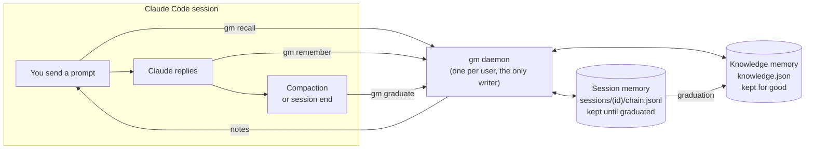

Three Claude Code hooks run `gm`: UserPromptSubmit runs `gm recall`, Stop runs
`gm remember`, and a compaction or the end of a session runs `gm graduate`. Graduation
is where a model distils session memory into knowledge. Each `gm` call sends one request over a Unix socket to the daemon and exits
within milliseconds. The daemon does the work. If anything fails, the hook logs it to
`~/.graph-memory/gm.log` and exits 0, so Claude carries on without memory for that turn.

The daemon starts on the first hook that needs it and stops after 30 idle minutes.

There are two kinds of memory:

| | Session memory | Knowledge memory |
|---|---|---|
| What | The turns of a live session: your prompt, Claude's reply, files touched, pages read | Single pieces of knowledge: decisions, facts, preferences, pitfalls, procedures, open items, things you learned |
| Where | `~/.graph-memory/sessions/<session>/chain.jsonl` | `~/.graph-memory/knowledge.json` and `knowledge_vectors.json` |
| How long | Until the turns graduate; the session's folder goes when the session ends | For good; it fades and gets retired, but only you delete it |
| Used by | Graduation, and recall (to tell which topics the session is about) | Recall |

---

## 1. Remember

Remembering happens in two steps. Each finished turn is first stored as it is in session
memory, which is cheap and instant. Later, a model distils those turns into knowledge
memory. This step is called **graduation**.

### 1.1 Recording a turn

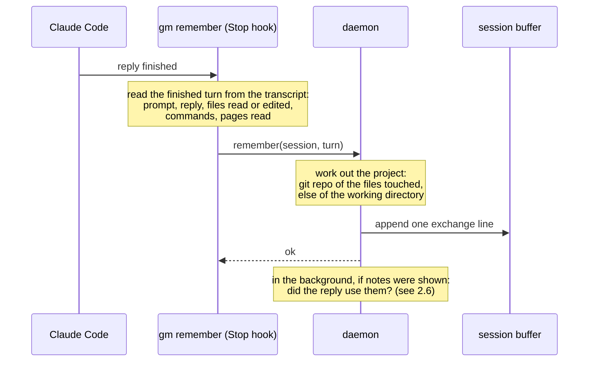

No model and no embedding are involved, so this takes a few milliseconds. One turn
becomes one line:

```json
{"kind": "exchange", "id": "a1f0c2…", "ts": "2026-11-07T01:50:47Z",
 "prompt": "does sqlite check my foreign keys by default?",
 "reply": "No. SQLite only enforces foreign keys after PRAGMA foreign_keys = ON, …",
 "files": [], "commands": [],
 "web": ["https://www.sqlite.org/foreignkeys.html"],
 "project": null}
```

`project` is `null` here because that session ran outside any git repository.

Some turns are handled differently:

| Situation | What happens |
|---|---|
| A background task finished and the turn went on | The same exchange is updated with the longer reply, and no new line is added |
| You rewound the conversation | The exchanges after the point you went back to are dropped, so they never graduate |
| A slash command | Stored as the prompt `/name args` |
| A session a program drives (`claude -p`, the Agent SDK) | Not recorded, and nothing is recalled into it, unless `remember_headless = true` |

### 1.2 Session memory: the buffer

A session's file holds **exchanges** that have not graduated yet and **summaries** of
the ones that have:

```
sessions/claude-code:5d2e81a0…/chain.jsonl
  {"kind": "summary", "trigger": "idle", "exchanges": 32, "graduations": 13, "text": "The session finished the topic-scoping work …"}
  {"kind": "exchange", "prompt": "…", "reply": "…"}     ← waiting to graduate
  {"kind": "exchange", "prompt": "…", "reply": "…"}     ← waiting to graduate
```

Graduation is triggered by these events:

| Trigger | When | Claude Code hook |
|---|---|---|
| `idle` | The session has been quiet for 20 minutes (`graduation_idle`) | none: the daemon checks every minute |
| `compact` | Claude Code compacted the context | SessionStart with source `compact` runs `gm graduate` and passes Claude's own summary |
| `session_end` | You closed the session | SessionEnd runs `gm graduate` |
| `manual` | `gm knowledge graduate <session>`, `gm knowledge backfill`, or "Graduate now" on the Sessions page | none |
| `abandoned` | Nothing happened in the session folder for 7 days | none: the daemon checks |

After a graduation, the exchanges it covered are replaced by a summary. A session keeps
**one rolling summary**: each graduation reads the current summary and writes a new
version that folds in what was just learned. A compaction is a boundary. Claude's own
compact summary becomes a summary line of its own, and the next graduation starts a new
rolling summary after it.

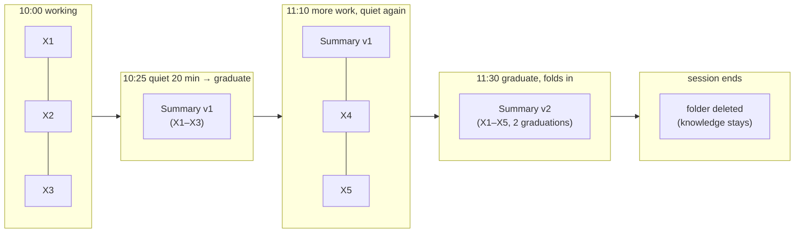

A real rolling summary, from the session that wrote this page:

```json
{"kind": "summary", "trigger": "idle", "exchanges": 32, "graduations": 13,
 "start": "2026-11-05T08:54:17Z", "end": "2026-11-09T08:52:52Z",
 "text": "The session finished the topic-scoping work for graph_memory: the 22 proposed
          scope moves were applied to live memory, and the topic-scope code was committed
          and pushed to main as 23523fd. The open item about starting the gm daemon at
          login was dropped because the user does not want it; …"}
```

The summary serves three purposes. It gives the next graduation context about the
session so far. It helps recall tell which topics the session is about (2.1). It also
shows on the Sessions page what a session has covered.

### 1.3 Graduation: from exchanges to knowledge

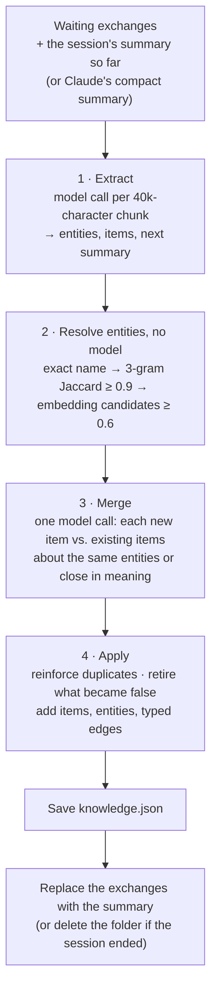

By default the model is Haiku, run through `claude -p` with your existing login. Each
graduation makes two calls. They run in the background, so you never wait for them.

**Step 1, Extract.** The model reads the exchanges, with prompts cut to 1,000 characters
and replies to their first 1,800 and last 700. It keeps knowledge that is durable,
useful later and specific, and skips narration, greetings and test counts. For a turn
of the SQLite session, the model answers:

```json
{"entities": [{"name": "SQLite", "kind": "tool", "summary": "embedded SQL database"},
              {"name": "recipe_tag table", "kind": "component", "summary": "join table of recipes and tags"},
              {"name": "tag table", "kind": "component", "summary": "the tags recipes can carry"}],
 "items": [{"type": "fact",
            "statement": "SQLite enforces foreign keys only after PRAGMA foreign_keys = ON, and the setting is per connection, so every connection must turn it on.",
            "why": "The SQLite foreign key docs say enforcement is off by default for backwards compatibility.",
            "entities": ["SQLite", "recipe_tag table", "tag table"],
            "scope": "topic", "topic": "SQLite",
            "origin": "docs", "ref": "https://www.sqlite.org/foreignkeys.html",
            "volatility": "stable", "evidence": ["X1"]}],
 "summary": "The user is sketching a recipe app's schema in SQLite, with recipes and tags joined by recipe_tag …"}
```

There are seven item types:

| Type | Example |
|---|---|
| decision | recipe_tag's primary key is `(recipe_id, tag_id)`, so tagging a recipe twice is a no-op under `INSERT OR IGNORE` |
| fact | SQLite enforces foreign keys only after `PRAGMA foreign_keys = ON` … |
| preference | When the user asks about SQLite, answer from the SQLite documentation, not from memory |
| pitfall | Index `recipe_tag.tag_id`: without it, deleting a tag scans the whole join table to check the foreign key |
| procedure | How to do something that worked |
| open | trip-planner's calendar export has not yet been tested with a real calendar app |
| learned | A many-to-many in SQLite needs a join table; `WITHOUT ROWID` suits one whose key is the two ids |

The model also records three things about each item: where it came from (`origin`:
user, docs, code, observed, assistant), what it applies to (`applies_to`, such as
`SQLite 3.45`) and how fast it can go stale (`volatility`). Section 3 uses all three.

**Choosing a scope.** The scope decides where an item can be recalled. The model picks
it for each item:

| Scope | Meaning | Example |
|---|---|---|
| `repo:/…/trip-planner` (project) | About one repository's own code, design or work | "The user chose Python for trip-planner's server and TypeScript for its web client" |
| `topic:SQLite` (topic) | About one technology or subject. Recalled in any project, but only once the session is about it | "SQLite enforces foreign keys only after …" |
| `global` | About you, your machine or how you like to work, whatever you work on | "Explain choices in plain terms" |

The model is told which topics memory already knows, so "SQLite" stays one topic and
doesn't become both "SQLite" and "sqlite". A session outside any git repository has no
project, so its design decisions go to their topic and not to global.

**Step 3, Merge.** New items are compared with existing ones. The model decides three
things for each new item:

- **duplicate of** an existing item: the old item is *reinforced*, which makes it
  stronger and adds a source;
- **makes false** an existing item: only when both cannot be true at once, such as a
  reversed decision, a replaced tool or a finished open item. The old item is retired
  but kept for history (section 3);
- **related to** an existing item, with a type (depends on, causes, refines,
  alternative, same area) and a strength (0.9, 0.6 or 0.3). This becomes an edge in
  the graph.

**Safety.** Knowledge is saved before the exchanges leave the buffer. A crash in between
graduates the same exchanges twice, and the merge removes the duplicates.

When graduation fails (the model is down, or its answer doesn't parse):

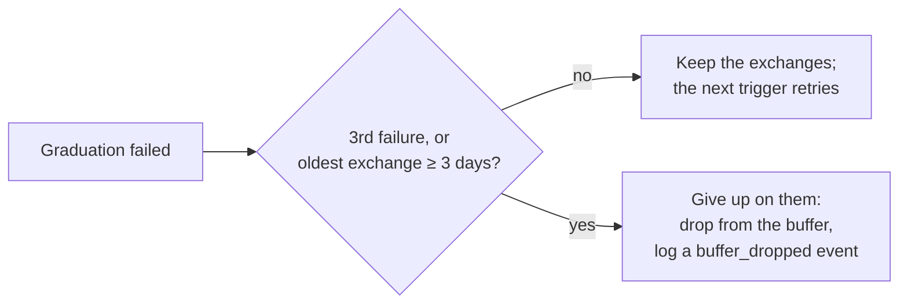

### 1.4 Knowledge memory: the graph

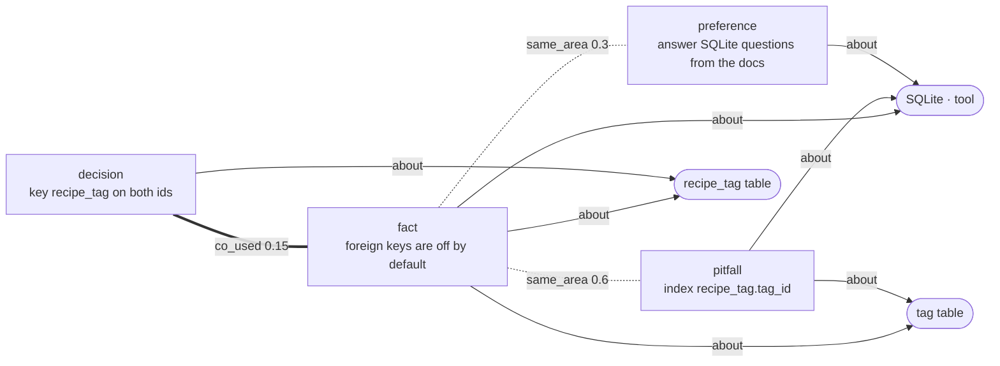

The graph has three kinds of parts:

- **Items** are the knowledge.
- **Entities** are the named things items are about: files, code symbols, components,
  tools, projects, people by role and the machine. Items that share an entity are two
  steps apart, so recall can walk from one to the other.
- **Edges** link items. Some come from the merge call. Others need no model call:
  `co_occurs` (learned together about the same entity), `co_used` (used by the same
  reply, growing by 0.15 each time) and `supersedes` (from the item that made another
  false).

The fact above as it is stored, with some fields left out:

```json
{"item_id": "3b9d07e2a4c15f86", "type": "fact",
 "statement": "SQLite enforces foreign keys only after PRAGMA foreign_keys = ON, and the setting is per connection, so every connection must turn it on.",
 "why": "The SQLite foreign key docs say enforcement is off by default for backwards compatibility.",
 "scope": "topic:SQLite",
 "entities": ["SQLite", "recipe_tag table", "tag table"],
 "sources": [{"session": "claude-code:9c41f2b7…", "until": "2026-11-07T01:50:47Z"}],
 "valid_at": "2026-11-07T01:50:47Z", "invalid_at": null,
 "origin": "docs", "ref": "https://www.sqlite.org/foreignkeys.html",
 "volatility": "stable",
 "area": "survivor", "strength": 1.5, "uses": 1, "recalls": 2,
 "last_used": "2026-11-09T07:28:05Z"}
```

`sources` records which sessions taught the item, now that their exchanges are gone. The
fields `area`, `strength`, `uses` and `last_used` describe the item's life, which
section 3 covers.

---

## 2. Recall

Recall runs before every prompt reaches Claude. It uses no model call. It takes a few
milliseconds plus one embedding of the prompt.

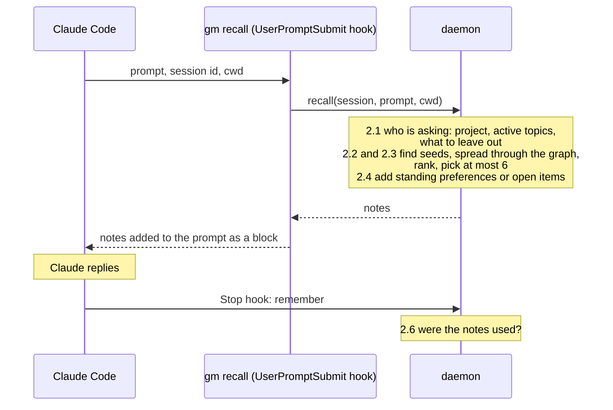

### 2.1 Who is asking

Recall first works out where the session is and what it can see.

- **Project**: the git repository of the session's working directory.
- **Active topics**: the known topics named in the prompt, in the session's waiting
  exchanges or in its summaries (the latest 40 records). Names match as whole words,
  ignoring case and `-`, `_` or space: "claude-code", "Claude Code" and "ClaudeCode" all
  match the topic Claude Code.
- **In scope**: an item is visible when its scope is `global`, this project, or an
  active topic.
- **Left out**:
  - items already shown in this session (until the next compaction; the daemon reads
    this back from its event log after a restart);
  - items the session can still see itself, because every source is this session and
    newer than its last compaction;
  - items no longer true, dormant, or volatile and past their review date (section 3).

### 2.2 Finding and ranking notes

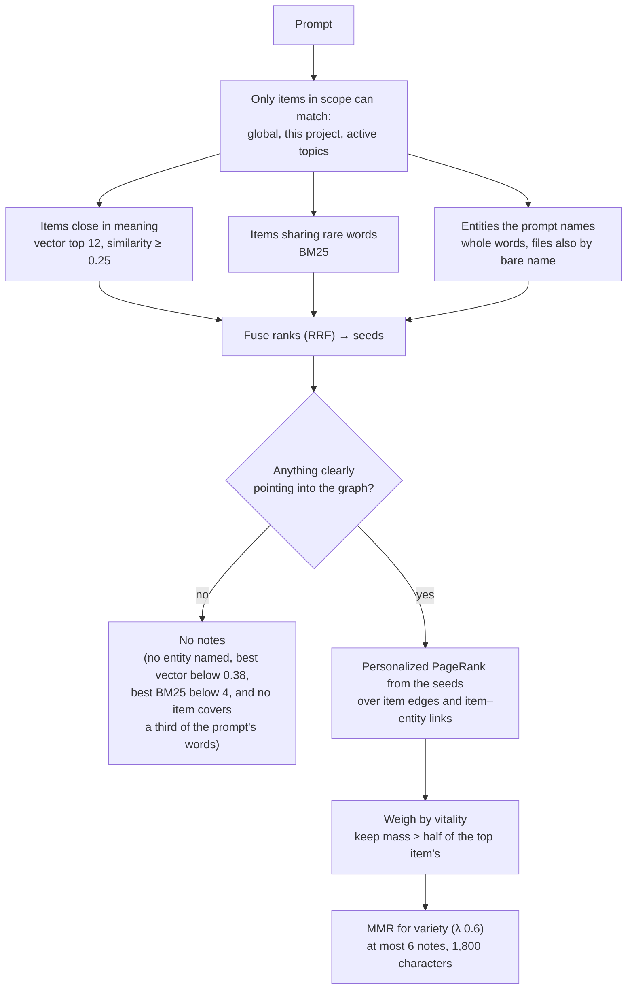

PageRank is what makes this a graph memory and not just a search. It spreads relevance
along edges, so a note can be recalled without sharing a single word with the prompt.
Examples are the pitfall about the file you named, or the reason behind a decision you
asked about. Links through an entity are damped by how many items it has, so a hub such
as the project's name doesn't pull in everything.

### 2.3 How the knowledge graph is used

Search alone finds notes that look like the prompt. The graph finds notes that are
*connected* to those, even when they share no words with the prompt. This is the step
called Personalized PageRank in the diagram above.

**What recall walks over.** Only notes that can be recalled are in this graph: notes no
longer true, dormant notes and the "replaced by" history links are left out.

| Connection | Where it comes from | Strength |
|---|---|---|
| Note to note, typed (depends on, causes, refines, alternative, same area) | The merge step of graduation | 0.9, 0.6 or 0.3 |
| Note to note, `co_occurs` | Learned together about the same entity | 0.25 |
| Note to note, `co_used` | Both used by the same reply | Starts at 0.15, grows by 0.15 each time |
| Note to entity | The note is about that file, tool or component | Weaker the more notes the entity has |

**How relevance spreads.** The method is Personalized PageRank, computed by *forward
push* (Andersen, Chung and Lang, "Local Graph Partitioning using PageRank Vectors",
FOCS 2006). Every node follows one rule with whatever relevance it holds: **keep 20%,
pass on 80%** to its neighbours, split in proportion to link strength.

A small example with four notes. The numbers on the links are their strengths, and the
prompt matches note A only, so A is the single seed and starts with all the relevance,
1.0.

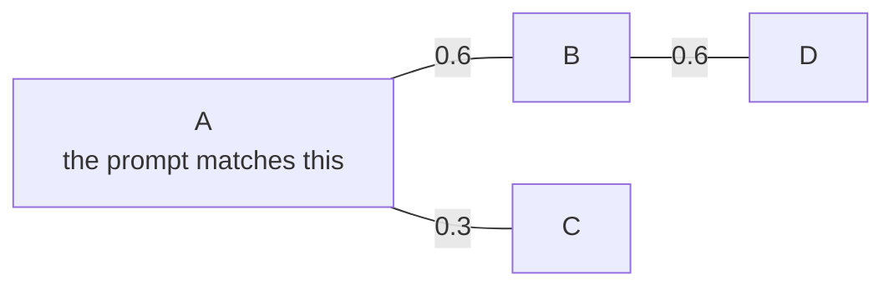

The first rounds:

1. A holds 1.0. It keeps 0.20 and passes on 0.80. Its links are 0.6 to B and 0.3 to C,
   so B gets two thirds (0.53) and C gets one third (0.27).
2. B holds 0.53. It keeps 0.11 and passes on 0.43, half back to A and half on to D,
   because both of its links are 0.6.
3. C holds 0.27. It keeps 0.05 and passes 0.21 back to A, its only neighbour.
4. A and D now hold relevance again and do the same, and so on.

A note's score is everything it kept, added up over all rounds:

| Note | Score | Why |
|---|---|---|
| A | 0.42 | The seed; relevance also keeps flowing back to it |
| B | 0.33 | Strongly linked to the seed |
| D | 0.13 | Two steps away, but through strong links |
| C | 0.11 | One step away, but through a weak link |

So the score says how close a note is to what the prompt matched, counting both
distance and link strength. D shares nothing with the prompt and is not linked to A, yet
it beats C because the path to it is strong.

With two seeds the picture changes. If the prompt matches both A and D, each starts
with 0.5, and B receives from both sides:

| Note | Score |
|---|---|
| B | 0.36 |
| A | 0.31 |
| D | 0.25 |
| C | 0.08 |

B now ranks first although the prompt never matched it.

**When it stops.** It cannot run forever, even though relevance flows around cycles
(A to B and back to A):

1. *The amount in motion shrinks every round.* A node keeps 20% before passing
   anything on, so at most 80% is still moving after one round, 64% after two, about
   11% after ten and about 1% after twenty. The total is 1.0 and is steadily used up.
2. *Small amounts are dropped.* A node passes relevance on only while it holds more
   than 0.0001 times the total strength of its links. Below that the amount stays where
   it is. This is what ends the process.
3. *A hard cap.* The code stops after 50,000 pass-on steps whatever happens. On a graph
   of this size it is never reached.

Because of the second rule, the work depends on the neighbourhood of the seeds and not
on the size of the whole graph: relevance fades below the threshold a few steps out, so
distant notes are never touched. That locality is the point of the forward push method,
and it is why this step takes a few milliseconds.

A note with no links has nowhere to pass relevance. It keeps its 20% and the rest is
discarded, so it can still be recalled as a direct match without outranking every
linked note.

**Two rules keep it from pulling in everything.** A link to an entity gets weaker the
more notes the entity has, so a hub such as the project's name passes on little. And
each node keeps only its 20 strongest links.

**A real example.** The prompt was:

> the diagram still doesn't look perfect. Some boxes hide the words behind them

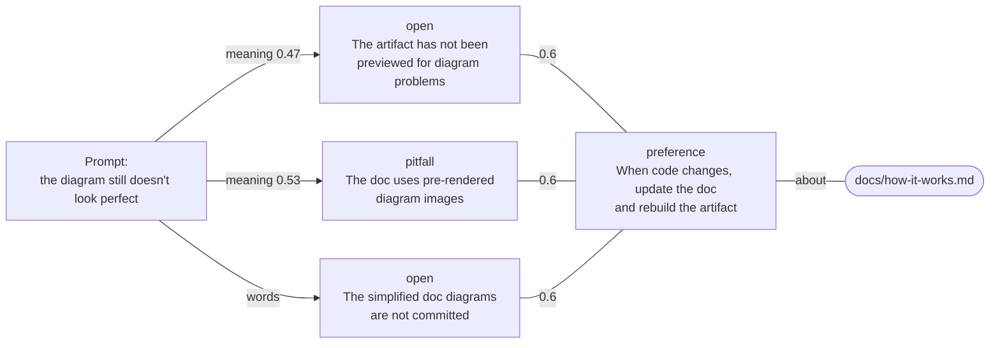

Search matched the three notes on the left, by meaning or by words. The preference on
the right shares almost nothing with the prompt: it says nothing about diagrams looking
wrong. It was recalled because all three matched notes link to it, so each passed it a
share of relevance. It is the note that mattered most for the next step: after fixing
the diagrams, the doc and the artifact both had to be updated.

**What the graph adds over search alone.**

| Situation | Search alone | With the graph |
|---|---|---|
| The prompt names a file | Notes that mention the file's name | Also the pitfall about that file, through the file's entity |
| The prompt asks about a decision | The decision | Also the reason it depends on, through a `depends_on` link |
| Several weak matches point at one note | Each weak match separately | The shared neighbour rises, as in the example |
| Two notes are always used together | Whichever matches | Both, through their `co_used` link |

**The graph learns from use.** Each time a reply uses two recalled notes together, their
`co_used` link gets stronger (2.6), so notes that prove useful together get recalled
together.

**How well it works so far.** In the first week of real use, notes reached only through
links were used by the reply 33% of the time (6 of 18), against about 50% for notes
matched directly. The graph does find notes search would miss, but it is also the main
source of notes that don't help.

### 2.4 Two shortcuts

- **Standing preferences.** On a session's first prompt, and on the first after a
  compaction, up to 3 of your preferences in scope come first, whatever the prompt says.
  "Keep answers short" shares no words with any prompt, but it applies to all of them.
- **Open items.** Prompts such as "what's left?", "where were we?" or "continue" name no
  work, so word and meaning matching can't find anything. They get the 3 newest open
  items: of the project the prompt names, else the session's project, else any project.

### 2.5 Examples

These follow the made-up story: the notes were learned in the SQLite session, and the
prompts come from a later session in the `trip-planner` project. The scores show the
shape of a typical result.

**Example 1: the prompt names a topic.**

> why doesn't sqlite stop me from deleting a tag that recipes still use?

The prompt names SQLite, so `topic:SQLite` is active and the SQLite notes are in scope
even though this is the trip-planner project. "SQLite" is also a known entity, so it
seeds PageRank as well. Recall returns 5 notes (listed here by score; MMR decides the
order Claude sees):

| Score | Reached by | Note |
|---|---|---|
| 1.00 | meaning 0.61, words 10.4 | SQLite enforces foreign keys only after `PRAGMA foreign_keys = ON` … |
| 0.86 | words 7.2 | Index `recipe_tag.tag_id`: without it, deleting a tag scans the whole join table … |
| 0.81 | meaning 0.49, words 6.3 | recipe_tag's primary key is `(recipe_id, tag_id)` … |
| 0.74 | graph only | When the user asks about SQLite, answer from the SQLite documentation … |
| 0.69 | words 5.8 | `ON DELETE CASCADE` on recipe_tag removes a deleted recipe's tag links … |

**Example 2: the same question without the topic.**

> why doesn't the database stop me from deleting a row that others still use?

Nothing in the prompt or the session names SQLite, so the SQLite notes are out of scope.
They cannot match, and they cannot pass their relevance to other notes through shared
entities, so recall shows nothing. This is what topic scope is for: SQLite knowledge stays
out of sessions that aren't about SQLite. Once a reply in the session mentions SQLite,
the topic becomes active and the same prompt gets the notes.

**Example 3: asking what is left.**

> what's left to do?

The shortcut returns the 3 newest open items of `trip-planner`, such as "trip-planner's
calendar export has not yet been tested with a real calendar app".

**What Claude sees.** The notes are added to the prompt as a block:

```
<graph-memory>
Knowledge from earlier sessions that may apply here:
- [fact, 2026-11-08, from docs, SQLite] SQLite enforces foreign keys only after PRAGMA foreign_keys = ON, and the setting is per connection, so every connection must turn it on. (why: The SQLite foreign key docs say enforcement is off by default …)
- [preference, 2026-11-07, SQLite] When the user asks about SQLite, answer from the SQLite documentation, not from memory. (why: …)
Each note shows when it was last confirmed and where it came from. Notes can be out of date: what you see now in the code, docs or tool output wins, and say so when it contradicts a note.
</graph-memory>
```

Each note starts with a tag: the type, the date it was last confirmed, where it came
from, and the topic or version it applies to. A note from another project ends with
`[project: name]`. A note in doubt carries a warning: `[disputed …; check it before
relying on it]` or `[not re-checked since …; verify it before relying on it]`.

### 2.6 After the reply: learning from use

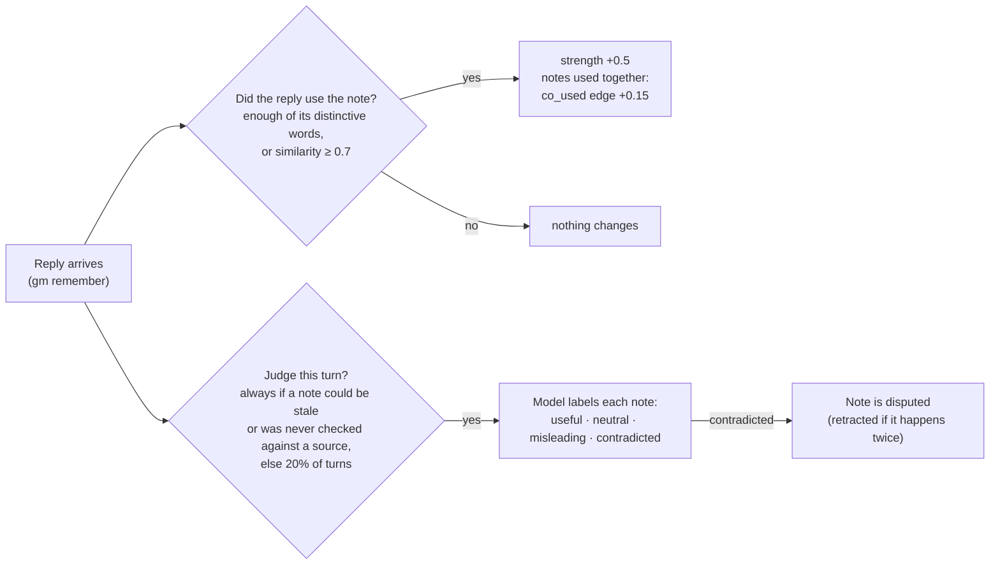

The use check needs no model. A reply uses a note when it repeats half of the note's
distinctive words (at least two), or three that make up 30% of them, or four, or when it
nearly restates the note. Used notes get stronger, and notes used together become linked,
so PageRank learns from real use which notes belong together. The Memory help page
(`/help`) and `gm stats` show how often recall gave Claude notes and how often replies
used them.

### 2.7 How the search is implemented

Recall has no vector database and no search server. Everything is held in the daemon's
memory and searched exactly.

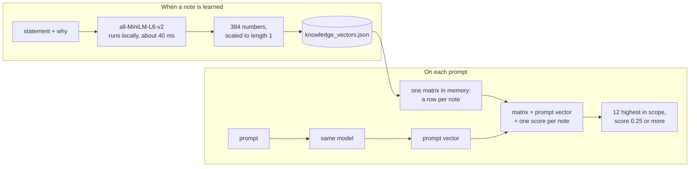

**Meaning (vectors).**

- **The model.** all-MiniLM-L6-v2 turns a text into 384 numbers. It ships with the
  `chromadb` package and runs on your CPU, so nothing leaves the machine. Chroma's
  database is not used, only its model.
- **Storage.** Each note's vector is made once, from its statement and reason, when the
  note is learned. All vectors live in one file, `knowledge_vectors.json`, as base64 of
  32-bit floats, which is about a third the size of decimal text. Entities have vectors
  too. Graduation uses them to match names; recall searches note vectors only.
- **Search.** Vectors are stored scaled to length 1, so the dot product of two vectors
  is their cosine similarity. The daemon holds all vectors as one numpy matrix and
  multiplies it by the prompt's vector. That gives the exact similarity of the prompt
  to every note in one step. On 384 vectors it takes about 0.1 ms. The matrix is
  rebuilt on the first search after a note is added or removed.
- **Why no vector database.** A vector database avoids comparing the prompt with every
  vector by using an approximate index, which pays off with millions of vectors. Here
  there are a few hundred, and the exact comparison is far cheaper than embedding the
  prompt. A database would also add startup time for a daemon that restarts often, and
  a second store to keep in step with `knowledge.json`.

**Words (BM25).**

- Each note's text (statement, reason and the names of its entities) is split into
  words, with stop words removed and endings trimmed so "tests" matches "test". A
  hyphenated word also counts as its parts.
- The daemon keeps a word count per note and how many notes contain each word. It
  rebuilds these whenever the knowledge changes.
- For a prompt, it scores every note in scope with the standard BM25 formula
  (k1 = 1.2, b = 0.75): rare words count more, and long notes are not favoured. There is
  no inverted index yet, so this is a loop over the notes. That is fast at hundreds of
  notes and would need an index at tens of thousands.

**Where the time goes.** A recall takes about 46 ms in the daemon at the median. About
40 ms of that is embedding the prompt. The two searches, PageRank and ranking share the
rest.

---

## 3. Archive

graph-memory has no archive store. Archiving here means what happens to memory as it
ages. Session memory is put away as soon as it has been distilled. Knowledge is never
deleted on its own, but it moves through states that decide whether recall still shows
it.

### 3.1 What is kept, and for how long

| What | Kept | Then |
|---|---|---|
| A waiting exchange | Until its session graduates (20 quiet minutes, compaction, session end) | Replaced by the session's summary |
| A session's summary | Until the session ends, or 7 days without activity | The session's folder is deleted |
| Exchanges whose graduation keeps failing | 3 failures, or 3 days | Dropped, and a `buffer_dropped` event is logged |
| Knowledge items | For good | They fade, retire or get deleted by hand, as described below |
| Deleted items | In `knowledge_deleted.jsonl` | `gm knowledge undelete <batch>` puts them back |
| The event log (`events.jsonl`) | 30 days (`events_days`) | Pruned once a day |
| Claude Code's own transcripts | 30 days, by Claude Code | Until then, `gm knowledge regraduate` can rebuild a session's knowledge from them |

### 3.2 The life of an item

Two things change over an item's life, independently: how alive it is (its **area**),
and whether it is still **true**.

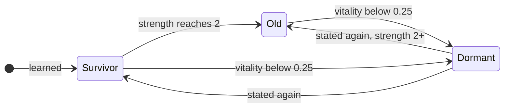

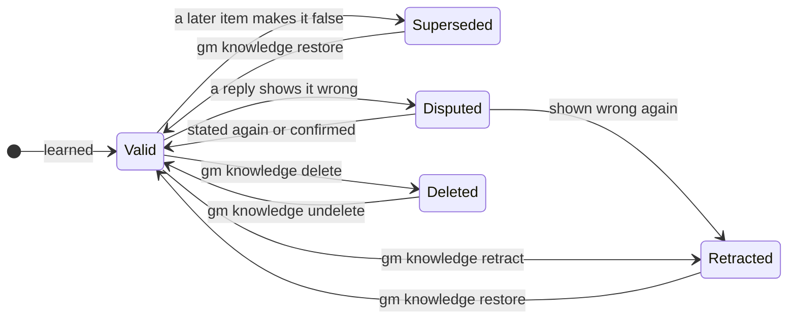

Only *valid* items that are not dormant are recalled. A disputed item is still recalled,
with a warning.

**Fading: survivor, old, dormant.** Item areas work like the JVM's generations. Every
item starts as a *survivor*. An item that proves itself becomes *old*: it was stated
again by a later session (+1 strength) or used by replies (+0.5 each), and reached
strength 2. An item's **vitality** is its strength, halved every *half-life* since it was
last seen or used:

| Area | Half-life | Example |
|---|---|---|
| survivor | 14 days | A new item (strength 1) that is never used or stated again falls below 0.25 after **28 days** and goes dormant |
| old | 90 days | An item at strength 2 lasts **270 days** without use; at strength 4, 360 days |
| dormant | 14 days | Kept, but not recalled. It keeps fading |

A dormant item is not lost. When a later session states it again, it comes back. The
daemon moves faded items to dormant during its maintenance pass, which runs every
minute. Vitality also nudges ranking: a fresh survivor's PageRank mass counts about 0.6
to 0.8, and an item whose vitality is 3 or more counts 1.0.

**Retiring: no longer true.** Knowledge changes, and memory keeps the history:

- **Superseded.** A later graduation learns something that makes an item false. For
  example, "How recipes and tags are linked is still open, leaning toward a join table"
  is replaced by the decision once it is made. The old item gets the date it stopped
  being true and a `supersedes` edge from the new one. It is never recalled again, but
  `gm knowledge show` and the Knowledge page still show it.
- **Disputed, then retracted.** When the judge finds a reply showing a note wrong, from
  code, docs or tool output, the note is *disputed* and shown with a warning. A second
  contradiction retracts it. A change the reply itself makes doesn't count, because the
  note was right until then.
- **Retracted by hand.** `gm knowledge retract <id>` handles the case where no session
  says what replaced the item. `gm knowledge restore <id>` undoes any of these.

**Going stale: review dates.** Some knowledge goes out of date without anyone saying
so, such as how a release of a tool behaves or what the latest version is.
`volatility` sets a review date, counted from when the item was last confirmed:

| Volatility | Review after | Past the review date |
|---|---|---|
| stable (concepts, decisions, preferences, open items) | never | |
| versioned ("how SQLite 3.45 does X") | 180 days | Still recalled, tagged `[not re-checked since …; verify it]` |
| volatile ("the latest version is 8.2", prices, status) | 30 days | No longer recalled |

Stating the item again in a later session, or running `gm knowledge confirm <id>`,
starts the review period over. `gm knowledge review` lists what is disputed or due.

**Deleting: only by hand.** `gm knowledge delete <id>` is for noise that was never
worth keeping. The item leaves the graph with its edges. Two neighbours that were linked
only through it would drift apart, so they get a **bridge** edge. Its strength is their
two links multiplied, and there are at most 6 bridges per deletion. Every deletion is
written in full to `knowledge_deleted.jsonl`, and `gm knowledge undelete <batch>` puts
it back and removes its bridges.

### 3.3 Moving or rebuilding knowledge

- `gm knowledge rescope` has the model re-check every item's scope and writes a
  proposal. `--apply` keeps it. `gm knowledge scope <id> --to …` moves one item by hand.
- `gm knowledge regraduate <session>` graduates a whole session again from Claude Code's
  transcript, under the current rules. A long session is previewed on a copy of memory
  first.
- `gm knowledge resummarize <session>` folds a session's summaries into one without
  touching its knowledge.

### 3.4 The one real archive file

`gm migrate` is the one-time move from the old conversation-graph design, which kept
every exchange for good. It packs the old files into `archive-<date>.tar.gz`, checks the
archive opens, and only then deletes them. The archive is yours to keep or delete; the
system never reads it again.
